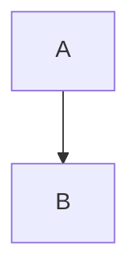

# 文章详情 Markdown 渲染逻辑与代码块语言清单

整理日期：2026-08-10

## 结论概览

文章详情页的 Markdown 正文不是由客户端编辑器接管渲染，而是先经过 `renderMarkdownToHtml()` 生成 HTML，再通过 `.article-body-ssr` 使用 `v-html` 直出。核心渲染逻辑在前台项目 `portal-web/utils/markdown.ts`，后台 `admin-ui/src/utils/markdown.ts` 是它的纯客户端适配版，目标是让后台写作预览与前台文章详情保持一致。

代码块高亮由 Shiki 提供，主题是 `github-dark`。当前支持范围来自三类：

- Shiki 当前安装版本内置的 332 个语言 key。
- 项目自定义补充的 `thrift`、`plantuml`、`dot`。
- 项目维护的一批 fence 别名，例如 `golang -> go`、`mysql -> sql`、`docker-compose -> yaml`。

`mermaid` 是特殊分支：它仍然写在 Markdown 代码块里，但不会走 Shiki 高亮，而是输出 Mermaid 占位 DOM，客户端再调用 `mermaid.render()` 生成 SVG。

## 代码入口

前台文章详情：

- 页面文件：`/Users/bytedance/portal-web/pages/article-detail/[id].vue`
- 模板出口：`article.renderedHtml` 通过 `<div class="article-body-ssr" v-html="article.renderedHtml"></div>` 输出。
- SSR 数据路径：接口返回 `content` 后，页面调用 `await renderMarkdownToHtml(md)` 得到 `renderedHtml`，同时提取摘要和首图，然后剥离 Markdown 原文，减少水合数据体积。
- SPA 兜底路径：客户端路由切换时如果需要重新取文章内容，也会调用同一个 `renderMarkdownToHtml(result.data.content)`，保证规则一致。

后台预览：

- 组件文件：`/Users/bytedance/admin-ui/src/components/article-preview.vue`
- 渲染入口：监听 `props.markdown`，防抖后调用 `renderMarkdownToHtml(src)`。
- PC 预览：直接在 `.article-body-ssr.article-preview` 上 `v-html`。
- 手机 / 平板预览：把渲染后的 HTML 写入 iframe `srcdoc`，并注入文章详情样式。

核心工具：

- 前台：`/Users/bytedance/portal-web/utils/markdown.ts`
- 后台适配：`/Users/bytedance/admin-ui/src/utils/markdown.ts`
- 语言归一化：`/Users/bytedance/portal-web/utils/shikiLanguages.ts` 与 `/Users/bytedance/admin-ui/src/utils/shikiLanguages.ts`

## Markdown 渲染主流程

1. 构造 `MarkdownIt` 单例，开启 `html`、`linkify`、`breaks`、`typographer`。
2. 加载 `markdown-it-footnote`，支持 `[^1]` 脚注。
3. 注册自定义块：
   - Admonition：`!!! tips/info/warning/error/success/thinking/example/summary ... !!!`
   - 数学公式：行内 `$...$` 和块级 `$$...$$`，通过 KaTeX 渲染。
   - fence 代码块：自定义输出代码块结构、行号、复制、折叠、全屏按钮。
   - Mermaid：` ```mermaid ` 输出占位 DOM，客户端再渲染 SVG。
   - 表格：外包 `.ssr-table-wrap` / `.ssr-table-scroll`，并带全屏按钮。
   - 图片：补充 `.article-img.article-img-zoomable`、`loading="lazy"`、`decoding="async"`，自有 COS 图片额外补 `srcset/sizes`。
   - 标题：给 heading 生成稳定 `id`，供目录和同步滚动使用。
4. `renderMarkdownToHtml()` 每次创建独立 `RenderEnv`，执行 `md.render()`。
5. `md.render()` 阶段遇到普通代码块时只放 Shiki 占位符，并把 `{ lang, rawCode }` 收集到 `pendingHighlights`。
6. `resolveShikiPlaceholders()` 异步加载 Shiki 主题和语言，把占位符替换成带 `<span class="ssr-code-line">...</span>` 的高亮 HTML。
7. 最后执行图片属性后处理并返回完整 HTML。

## 代码块渲染细节

代码块 fence 的语言处理流程：

1. 读取 `token.info` 的第一个单词作为语言标识，例如 ` ```go title="x" ` 只取 `go`。
2. 转小写得到 `rawLang`。
3. 调用 `normalizeCodeFenceLanguage(rawLang)` 做本地别名归一化。
4. 如果归一化后是 `mermaid`，输出 Mermaid 占位结构，不进入 Shiki。
5. 其他语言进入 Shiki 占位流程。

Shiki 加载逻辑：

1. `createHighlighter({ themes: ['github-dark'], langs: [] })` 只预加载主题。
2. 每个代码块按需加载语言。
3. `ensureLanguageLoaded()` 的判断顺序是：
   - `text/plain/plaintext/txt`：按纯文本处理，不加载语法。
   - 已加载过的语言：直接复用。
   - 项目自定义语言：加载自定义 `LanguageRegistration`。
   - Shiki 内置语言：调用 `highlighter.loadLanguage(lang)`。
   - 都不命中：返回不支持。
4. `codeToTokens()` 成功后把 token 转成逐行 HTML。
5. 如果高亮失败、语言不支持，或首次客户端高亮触发空 token 竞态，最终都会降级为 `rawCodeToLinesHtml()`，保证代码内容仍然可见，只是没有颜色。

代码块 DOM 特性：

- 外层：`.ssr-code-block`
- 语言展示：`.ssr-code-lang`，显示原始 fence 标识；例如写 `golang` 会显示 `golang`，但实际按 `go` 高亮。
- 行号：`.ssr-code-gutter` 内逐行输出 `.ssr-code-num`。
- 代码行：每行一个 `.ssr-code-line`，空行用零宽字符占位。
- 超过 30 行：写入 `data-collapsible="true"`、`data-collapsed="true"`，默认折叠。
- 操作：复制、折叠 / 展开、全屏按钮都通过事件委托绑定。

## 项目自定义语言

这些语言不属于当前 Shiki 内置 key，由项目在 `shikiLanguages.ts` 里补充 TextMate grammar：

- `thrift`：Thrift IDL，别名 `idl`、`thrift-idl`、`apache-thrift`
- `plantuml`：PlantUML，别名 `puml`、`uml`
- `dot`：Graphviz DOT，别名 `graphviz`、`gv`

## 项目本地别名

这些 fence 标识会先被归一化：

- `idl`、`thrift-idl`、`apache-thrift` -> `thrift`
- `puml`、`uml` -> `plantuml`
- `graphviz`、`gv` -> `dot`
- `golang` -> `go`
- `node`、`nodejs` -> `javascript`
- `javascriptreact` -> `jsx`
- `typescriptreact` -> `tsx`
- `mysql`、`mariadb`、`mssql`、`postgres`、`postgresql`、`psql`、`sqlite`、`sqlite3`、`tsql` -> `sql`
- `pb` -> `proto`
- `conf`、`config`、`cfg` -> `ini`
- `env` -> `dotenv`
- `shell-session`、`shellsession` -> `shellsession`
- `cplusplus` -> `cpp`
- `objectivec` -> `objective-c`
- `compose`、`docker-compose` -> `yaml`
- `plain`、`plaintext`、`txt` -> `text`

说明：`text/plain/plaintext/txt` 是纯文本，不做语法着色；无语言 fence 也会按原文可见输出。

## Mermaid 特例

写法：

````md

````

渲染行为：

- SSR / Markdown 阶段输出 `.mermaid-block[data-mermaid-rendered="false"]`。
- 原始 Mermaid 源码放在 `<pre class="mermaid-source">` 里。
- 客户端 mounted 后查找未渲染的 `.mermaid-block`，动态导入 `mermaid` 并调用 `mermaid.render(id, source)`。
- 成功时把 `.mermaid-content` 替换成 SVG，失败时显示 `.mermaid-error`。
- 只有 `mermaid` 会进入图表渲染分支；`mmd` 是 Shiki 内置 key，在当前逻辑里会按普通代码块高亮，不会渲染成图表。

## Shiki 内置语言 key

以下清单来自当前 `admin-ui/node_modules/shiki` 的 `bundledLanguages`，共 332 个 key。代码块 fence 使用这些 key 时会按需加载并尝试高亮。

- `1c`, `1c-query`, `abap`, `actionscript-3`, `ada`, `adoc`, `angular-html`, `angular-ts`
- `apache`, `apex`, `apl`, `applescript`, `ara`, `asciidoc`, `asm`, `astro`
- `awk`, `ballerina`, `bash`, `bat`, `batch`, `be`, `beancount`, `berry`
- `bibtex`, `bicep`, `bird`, `bird2`, `blade`, `bsl`, `c`, `c#`
- `c++`, `c3`, `cadence`, `cairo`, `cdc`, `cjs`, `clarity`, `clj`
- `clojure`, `closure-templates`, `cmake`, `cmd`, `cobol`, `codeowners`, `codeql`, `coffee`
- `coffeescript`, `common-lisp`, `console`, `coq`, `cpp`, `cql`, `crystal`, `cs`
- `csharp`, `css`, `csv`, `cts`, `cue`, `cypher`, `d`, `dart`
- `dax`, `desktop`, `diff`, `docker`, `dockerfile`, `dotenv`, `dream-maker`, `edge`
- `elisp`, `elixir`, `elm`, `emacs-lisp`, `erb`, `erl`, `erlang`, `f`
- `f#`, `f03`, `f08`, `f18`, `f77`, `f90`, `f95`, `fennel`
- `fish`, `fluent`, `for`, `fortran-fixed-form`, `fortran-free-form`, `fs`, `fsharp`, `fsl`
- `ftl`, `gd`, `gdresource`, `gdscript`, `gdshader`, `genie`, `gherkin`, `git-commit`
- `git-rebase`, `gjs`, `gleam`, `glimmer-js`, `glimmer-ts`, `glsl`, `gn`, `gnuplot`
- `go`, `gql`, `graphql`, `groovy`, `gts`, `hack`, `haml`, `handlebars`
- `haskell`, `haxe`, `hbs`, `hcl`, `hjson`, `hlsl`, `hs`, `html`
- `html-derivative`, `http`, `hurl`, `hxml`, `hy`, `imba`, `ini`, `jade`
- `java`, `javascript`, `jinja`, `jison`, `jl`, `js`, `json`, `json5`
- `jsonc`, `jsonl`, `jsonnet`, `jssm`, `jsx`, `julia`, `just`, `kdl`
- `kotlin`, `kql`, `kt`, `kts`, `kusto`, `latex`, `lean`, `lean4`
- `less`, `liquid`, `lisp`, `lit`, `llvm`, `log`, `logo`, `lua`
- `luau`, `make`, `makefile`, `markdown`, `marko`, `matlab`, `mbt`, `mbti`
- `md`, `mdc`, `mdx`, `mediawiki`, `mermaid`, `mips`, `mipsasm`, `mjs`
- `mmd`, `mojo`, `moonbit`, `move`, `mts`, `nar`, `narrat`, `nextflow`
- `nextflow-groovy`, `nf`, `nginx`, `nim`, `nix`, `nu`, `nushell`, `objc`
- `objective-c`, `objective-cpp`, `ocaml`, `odin`, `openscad`, `pascal`, `perl`, `perl6`
- `php`, `pkl`, `plsql`, `po`, `polar`, `postcss`, `pot`, `potx`
- `powerquery`, `powershell`, `prisma`, `prolog`, `properties`, `proto`, `protobuf`, `ps`
- `ps1`, `pug`, `puppet`, `purescript`, `py`, `python`, `ql`, `qml`
- `qmldir`, `qss`, `r`, `racket`, `raku`, `razor`, `rb`, `reg`
- `regex`, `regexp`, `rel`, `riscv`, `ron`, `rosmsg`, `rs`, `rst`
- `ruby`, `rust`, `sas`, `sass`, `scad`, `scala`, `scheme`, `scss`
- `sdbl`, `sh`, `shader`, `shaderlab`, `shell`, `shellscript`, `shellsession`, `smalltalk`
- `solidity`, `soy`, `sparql`, `spl`, `splunk`, `sql`, `ssh-config`, `stata`
- `styl`, `stylus`, `surql`, `surrealql`, `svelte`, `swift`, `system-verilog`, `systemd`
- `talon`, `talonscript`, `tasl`, `tcl`, `templ`, `terraform`, `tex`, `tf`
- `tfvars`, `toml`, `tres`, `ts`, `ts-tags`, `tscn`, `tsp`, `tsv`
- `tsx`, `turtle`, `twig`, `typ`, `typescript`, `typespec`, `typst`, `v`
- `vala`, `vb`, `verilog`, `vhdl`, `vim`, `viml`, `vimscript`, `vue`
- `vue-html`, `vue-vine`, `vy`, `vyper`, `wasm`, `wenyan`, `wgsl`, `wiki`
- `wikitext`, `wit`, `wl`, `wolfram`, `xml`, `xsl`, `yaml`, `yml`
- `zenscript`, `zig`, `zsh`, `文言`

## 不支持语言的降级

如果 fence 写了未知语言，例如：

````md
```unknownlang
hello
```
````

实际行为是：

- 代码块仍然正常输出。
- 头部语言仍显示原始 `unknownlang`。
- 行号、复制、折叠、全屏仍可用。
- Shiki 不会着色，内容按 HTML escape 后逐行直出。

因此“支持语言”主要影响语法高亮和 Mermaid 图表渲染，不影响代码块基础展示。
